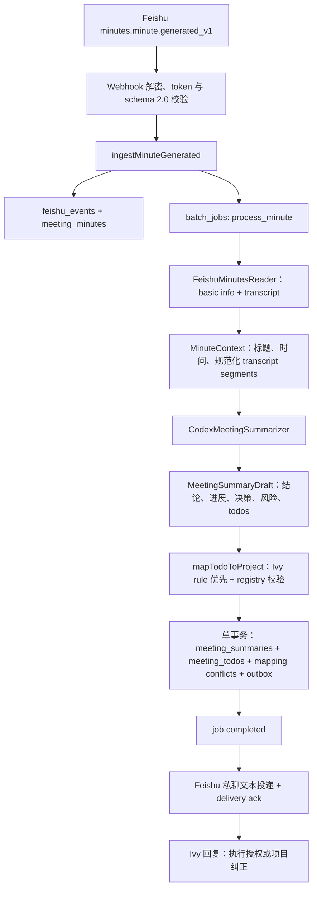
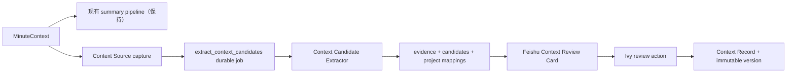
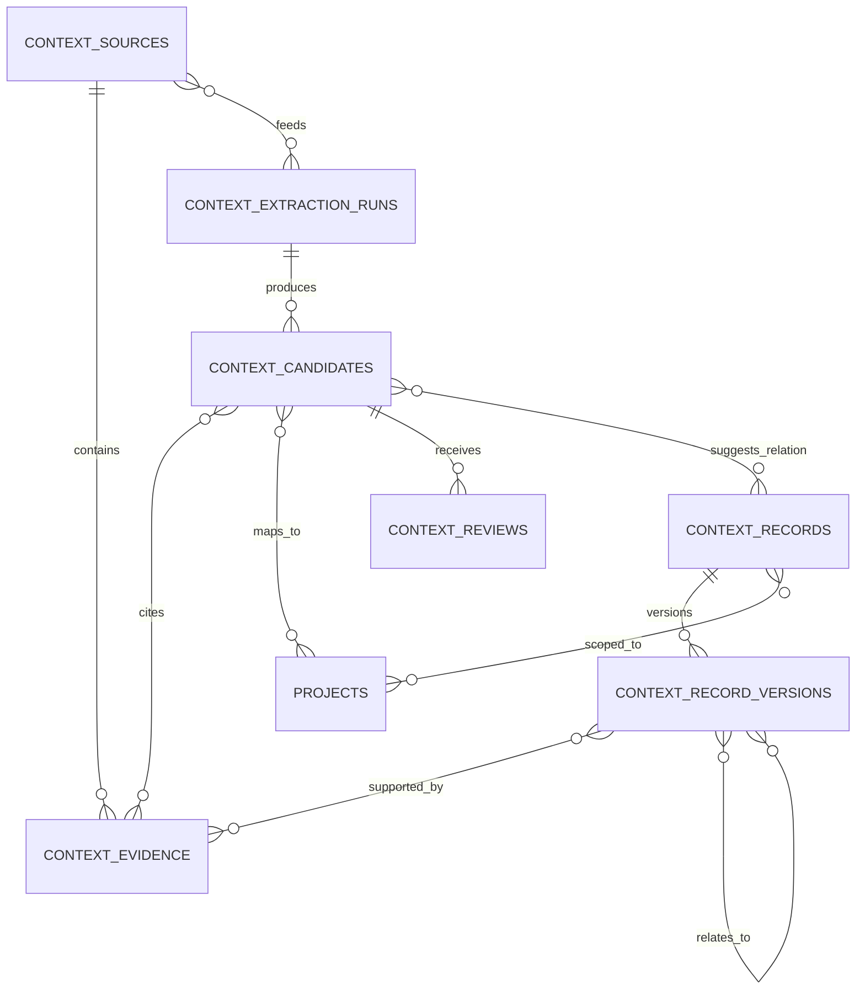

# Phase 1E 企业 Context 来源与更新模型设计

日期：2026-08-03  
状态：待 Ivy Review；未批准实施  
范围：工程基线审计、产品/领域模型、第一实现切片设计；不部署、不访问生产、不读取飞书历史群聊

## 0. 结论

Phase 1E 要建立的不是“把会议摘要写进 MEMORY”，而是一条可审计的企业 Context 升格管道：

```text
原始来源快照
  → 带原文片段的结构化候选
  → 项目归属、事实状态和旧 Context 关系判断
  → Ivy 审核
  → 正式 Context 逻辑记录 + 不可变版本
  → 后续证据继续确认、补充、纠正、取代或暴露冲突
```

推荐采用“证据优先的双层模型”：

1. 来源层保存不可变的来源快照和可复用证据片段；
2. Context 层严格区分 AI 候选、人工审核动作、正式记录和历史版本；
3. follow-up/Todo 继续是行动系统，不与 Context Candidate 或 Context Record 合表；
4. 妙记只是第一种 Adapter，核心表不出现 `minute_id`、`feishu_*` 或 `codex_*` 专用字段；
5. 第一版所有候选必须经 Ivy 审核，批准默认只表示“纳入正式 Context”，不自动把口头陈述提升为已验证事实。

第一实现切片应在现有妙记 reader 之后，用一个独立的小事务保存来源快照并入队 `extract_context_candidates` durable job，然后继续现有总结路径。候选提取失败不能阻塞现有 Phase 1D 总结、项目化 follow-up 或私聊投递。

## 1. 工程基线审计

### 1.1 Git 与用户已有改动

- 当前分支：`codex/phase1d-project-aware-followups`。
- 当前 HEAD：`932be35 docs: record phase1d project-aware plan`。
- `origin/codex/phase1d-project-aware-followups`、`origin/codex/phase1c-feishu-oauth` 和当前 HEAD 均指向 `932be35`。
- Phase 1D 相关提交从 `fe8c83e` 到 `932be35`，包含项目 registry、确定性 mapping、纠正、冲突、只读诊断和回归测试。
- 当前工作区在本轮开始前已有以下未提交内容，本轮不得覆盖或提交：
  - `AGENTS.md`：用户已有修改；更新项目阶段和生产边界。
  - `MEMORY.md`：用户已有修改；补充 Phase 1D 部署、PR 治理和 UAT 事实。
  - `docs/feishu-codex-ivy-workflow.html`：用户已有未跟踪文件。

### 1.2 本地门禁

2026-08-03 本轮只读审计后执行本地门禁：

- `pnpm test`：34 个测试文件、210 项测试全部通过；
- `pnpm typecheck`：通过；
- `pnpm build`：通过；
- `git diff --check`：通过。

本轮没有连接真实飞书、Codex CLI 或腾讯云，没有读取历史群聊。

### 1.3 文档状态

- `README.md` 仍描述 Phase 1A fixture 状态，已经明显落后于生产和 Phase 1D 事实；本轮只登记，不顺手改写。
- 2026-07-18 总体设计已经提出“不可变原始层 + 可版本化事实层”，但当前代码只实现会议总结/Todo 和 Project Registry，没有实现正式 `project_facts` 或通用 provenance 模型。
- Phase 1D 计划位于 `docs/superpowers/plans/2026-07-31-project-aware-followups.md`；本轮沿用 `docs/superpowers/specs` 和 `docs/superpowers/plans`，不另建文档体系。

### 1.4 当前数据库真实状态

当前 schema 有以下业务对象：

- `feishu_events`、`meeting_minutes`：妙记事件与 minute 去重；
- `meeting_summaries`、`meeting_todos`：AI 总结和可执行 follow-up；
- `projects`、`project_mapping_rules`、`project_mapping_conflicts`：Phase 1D 项目 registry、纠正规则和映射冲突；
- `project_context_snapshots`：飞书群上下文抓取的通用文本快照雏形；
- `batch_jobs`、`outbox`：durable job 和投递幂等；
- `approval_actions`：Todo 授权动作，不是 Context 审核记录；
- `feishu_user_oauth_tokens`：飞书用户 OAuth 运行状态。

关键缺口：

1. `meeting_minutes` 只保存 `minute_id/event_id/created_at`，不保存逐字稿、作者、来源链接、内容哈希或采集版本。
2. `meeting_summaries.content` 保存 AI 总结 JSON，不是原始证据。
3. `meeting_todos.project_evidence` 是项目映射理由，不是事实证据片段。
4. `project_context_snapshots` 缺少来源版本、作者、原文定位、review、事实状态和 record version，不能直接升格为企业 Context。
5. `project_mapping_conflicts` 只表达 Todo 项目归属冲突，不能表达企业事实之间的补充、纠正、取代或冲突。
6. `approval_actions` 只绑定 `meeting_todos`，其状态机和安全语义不适合复用为 Context 审核。
7. 当前 `MeetingSummaryDraft` 只有结论、进展、决策、风险和 Todo，没有 evidence span 或事实状态；prompt 中的“事实进展”要求无法替代数据层 provenance。

结论：现有表均不应改名或“扩字段后兼任”正式企业 Context。Phase 1E 应采用 additive schema，保留 Phase 1D 表和语义。

## 2. 当前真实链路



代码证据：

- 妙记事件解析、事件和 minute 幂等、`process_minute` 入队：`src/services/minute-ingestion.ts`。
- reader → summarizer → project mapper → summary/Todo/outbox 单事务：`src/services/meeting-worker.ts`。
- Codex schema/prompt：`src/adapters/codex-summarizer.ts` 与 `src/ports/summarizer.ts`。
- summary/Todo 持久化和 reply lookup：`src/repositories/meeting-repository.ts`。
- deterministic mapping：`src/services/project-mapper.ts`。
- 私聊投递幂等与 message ID ack：`src/repositories/outbox-repository.ts`、`src/adapters/feishu.ts`。
- Ivy 项目纠正和 Todo 授权：`src/services/reply-router.ts`。
- worker 当前只 lease/处理 `process_minute`：`src/composition/worker-runtime.ts`。
- `/diag/projects` 当前只返回聚合计数：`src/routes/project-diagnostics.ts`。

另一个实际差异是：当前 `sendMeetingSummary` 走 `sendTextMessage`，线上主总结路径是纯文本；代码虽已有通用 `sendInteractiveCard` 能力，但没有 Context review card renderer 或 card-action callback route。因此 Phase 1E 不能假设“审核卡片基础设施已经完整存在”，只可复用发送能力、Webhook 安全边界和 Ivy identity gate。

### 2.1 可复用对象

- `projects` 和人工 mapping rules：作为 Context 的项目 registry 与人工纠正基础。
- `batch_jobs` 的 stable key、lease、CAS 和重试语义：复用于候选提取 job。
- `outbox` 的 idempotency key 和 delivery ack 思路：复用于 Context review 卡片，但 payload 必须扩展为显式 union。
- Feishu OAuth reader、Webhook 验证、Ivy `open_id` allowlist：复用于来源采集和审核身份校验。
- Codex CLI 的只读、ephemeral、output schema 边界：复用于候选提取器。
- Zod + JSON Schema 双重校验：复用于候选输出。

### 2.2 不能直接承担企业 Context 的对象

- `meeting_summaries`：是面向 Ivy 的派生出版物，不是事实层。
- `meeting_todos`：是行动入口；授权、执行和完成状态不能代表企业事实状态。
- `project_context_snapshots`：可作为早期 source capture 经验，但 schema 只够做 prompt context，不够做 provenance。
- `project_mapping_conflicts`：只描述 Todo 的项目标签冲突。
- `approval_actions`：只描述 Todo 执行授权，不是 Context 的内容/事实/关系审核。

### 2.3 当前绑定点

- 飞书/妙记绑定：Webhook event type、`minute_id`、Feishu SDK reader、OAuth subscriber ID、`minute:<id>` job key。
- 会议绑定：`MinuteContext`、`meeting_*` 表、summary renderer、`minute-summary:<id>` outbox key。
- Codex 绑定只存在于 Adapter；`MeetingSummarizer` port 已隔离平台。
- Project Registry 本身不绑定飞书，但 `project_context_snapshots` 的首个生产来源设计绑定飞书群。
- `syncFeishuProjectContext` 目前只是受控 foundation；`server.ts` 没有启动历史同步调用。本轮继续保持未启用、未读取。

### 2.4 Phase 1E 插入点



候选提取必须是独立 job，而不是把 `contextCandidates` 塞进现有 `MeetingSummaryDraft`。原因：

- 现有总结 schema 已经在线验证；扩展 schema 会使候选验证失败同时阻塞总结。
- 总结与 Context 抽取的提示词、类型、事实边界和重试策略不同。
- 独立 job 可以单独重放、升级 extractor 版本和审计，不重复发送 Phase 1D summary。
- 对用户的影响是：会议总结仍按现有速度送达；Context review 可以稍后到达，失败时只影响 Context 候选，不影响 follow-up。

具体顺序是：reader 返回合法 `MinuteContext` 后，source snapshot 与 extraction job 在独立事务中幂等落库；当前 `process_minute` 随后继续原有 summarizer、project mapping、summary/Todo/outbox 事务。单 consumer 在正常路径会先完成当前 `process_minute`，再处理新排队的 Context job；进程崩溃时两条 job 可独立恢复。

## 3. 方案比较

### 方案 A：扩展 `meeting_summaries` / `meeting_todos`

改动最少，但把来源、事实、行动和审核混成会议专用表；未来聊天、文档、执行报告接入时必然复制或重构。无法正确表达一条正式 Context 的多来源、多版本和冲突关系。

结论：不采用。

### 方案 B：单表 `context_items`，用 status 区分 candidate/record/version

初期表少，但不同生命周期共享大量 nullable 字段，review、version、evidence 和 relation 约束只能依赖应用层。错误更新很容易静默覆盖历史。

结论：不采用。

### 方案 C：证据优先的来源—候选—正式记录三段式

用独立来源/证据、候选/review、逻辑记录/version/relation 表表达不可替换的语义；provider-specific 字段进入 Adapter metadata，不进入核心列。表数量更多，但每个表只有单一职责，SQLite 足以承担。

结论：推荐。它最直接地保护三个产品不变量：无证据不升格、无审核不正式、无静默覆盖。

## 4. 术语与来源地图

### 4.1 术语

- **Context Source**：在某个时间采集到的不可变来源快照。它可以是逐字稿、聊天消息、文档版本、表格行快照、人工补录或执行报告。
- **Evidence Span**：来源快照中的精确片段和定位信息，可被多条候选/正式版本复用。
- **Extraction Run**：某组来源由某个 extractor/prompt 版本处理的一次可审计运行。
- **Context Update Candidate**：AI 或规则从证据中提取出的原子命题；尚未进入正式企业 Context。
- **Review Action**：Ivy 对候选内容、事实状态和与旧 Context 关系作出的不可变审核事件。
- **Context Record**：一个长期逻辑身份，例如“FeishuAdaptor 当前阶段”或“公司会议录制政策”。
- **Context Record Version**：该逻辑记录在某次确认后的不可变内容版本。
- **Follow-up / Todo**：待执行行动。它可以和候选来自同一句话，但生命周期、授权和完成状态独立。

### 4.2 来源 Adapter 地图

| 来源 | Adapter 输出 | 第一版 | 核心层是否感知 provider |
|---|---|---:|---:|
| 飞书妙记逐字稿 | meeting transcript source + segments | 是 | 否 |
| 飞书妙记官方总结 | derived meeting summary source | 只预留 | 否 |
| 飞书聊天 | message/document source | 否 | 否 |
| 飞书文档 | document version source | 否 | 否 |
| 飞书多维表格/看板 | structured row snapshot | 否 | 否 |
| 腾讯会议/电话文本 | meeting transcript source | 否 | 否 |
| Ivy 人工补录 | manual statement source | 否 | 否 |
| 业务/执行结果 | business result / execution report | 否 | 否 |

Adapter 负责 provider、external ID、作者/参与人、采集方法、来源链接、内容格式和内容哈希。核心层只负责来源、证据、候选、审核、记录、版本和关系。

## 5. 不可违反的领域规则

1. 无 Evidence Span 的候选不能进入 `approved`。
2. 无 Ivy 审核动作不能创建正式 Context version。
3. `review_status=approved` 与 `factual_status=evidence_verified` 是两件事。
4. `reported_progress` 经批准后默认仍是 `reported`；除非审核时有直接证据或 Ivy 明确确认事实状态。
5. Candidate 内容不可原地改写；审核后的规范表述保存在 Review Action 和 Record Version。
6. Record Version 不更新旧内容；新信息创建新 version，并用显式关系连接旧 version。
7. 冲突状态不能自动选边；`conflict` 候选不能直接升格成替换旧记录。
8. follow-up 的 `completed` 不能自动更新 Context；执行结果必须作为新的 source/candidate 回流。
9. 项目 mapping confidence、内容 extraction confidence、factual status 三者分开保存。
10. provider-specific ID 不进入核心主键和枚举；核心 ID 使用稳定内部 ID。

## 6. 类型、事实状态与证据等级

### 6.1 Candidate / Record 类型

推荐第一版枚举：

| 枚举 | 语义 | 与任务系统的边界 |
|---|---|---|
| `proposal` | 尚未形成决定的建议 | 不是待执行授权 |
| `decision` | 明确形成的组织决定 | 记录“决定已形成”，不证明决定内容中的实施已完成 |
| `reported_progress` | 某人对进展的陈述 | 默认不是已验证工程/业务事实 |
| `claim` | 无足够验证证据的事实主张 | 替代含糊的 `unverified_claim`；未验证由 factual status 表达 |
| `risk` | 可能造成负面结果的不确定性 | 可长期保留直到关闭或失效 |
| `blocker` | 当前已经阻止推进的条件 | 与 risk 分开，便于经营判断 |
| `requirement` | 需求、政策或约束 | 可在后续被 supersede/correct |
| `status_update` | 已定义对象的状态变化 | 比 `project_update` 更通用；只有证据充分时才可 verified |
| `action_item` | 明确承诺/行动项的 Context 候选 | 不等同 `meeting_todos`；只有值得长期保留的承诺才升格 |

不直接照搬 `stated_progress/unverified_claim/project_update/task` 的原因：

- `reported_progress` 直接暴露“只是陈述”的证据边界；
- `claim` 的验证状态由独立字段表达，避免类型和事实状态重复；
- `status_update` 可复用于公司、项目、客户和交付对象；
- `action_item` 避免与可执行 `task`/Todo 实体混淆。

### 6.2 Factual status

推荐枚举：

- `source_attested`：来源能证明这句话/决定/提议被表达过，但不证明其内含事实。
- `reported`：来源陈述了某个事实或进展，尚无独立验证。
- `reviewer_confirmed`：Ivy 明确确认其作为当前公司事实/状态成立。
- `evidence_verified`：存在直接观测或权威业务/工程证据支持。
- `disputed`：存在未解决的相反证据或关系冲突。

默认规则：

- `proposal/decision/requirement/action_item` 初始为 `source_attested`；
- `reported_progress/claim/status_update/risk/blocker` 初始为 `reported`；
- extractor 不得输出 `reviewer_confirmed`；
- `evidence_verified` 需要 `direct_observation` 或 `authoritative_record` 证据，或 Ivy 在审核时明确选择并留下理由；
- 审核“通过”默认保留候选的 factual status，不自动升级。

### 6.3 Review status

- `pending`：等待 Ivy 审核；
- `approved`：已升格或已确认更新既有 Context；
- `rejected`：不进入正式 Context；
- `needs_clarification`：内容、范围、项目或事实状态不清楚；
- `conflict`：与旧 Context 存在未解决冲突，必须选择关系/版本策略。

Review Action 是 append-only；candidate 上的 `review_status` 是当前查询投影，通过事务内 CAS 更新。

### 6.4 Context relation

- `supplements`：新增细节，不使旧版本失效；
- `confirms`：新增证据支持相同内容；
- `corrects`：旧内容存在错误，新版本给出纠正；
- `supersedes`：旧内容曾正确，但已被新状态/政策取代；
- `conflicts_with`：两者不能同时成立，尚未裁决；
- `duplicates`：语义重复，不创建新的正式记录。

`corrects` 与 `supersedes` 必须分开：前者表示旧结论当时就不对，后者表示世界后来发生变化。

### 6.5 Evidence level 与作用

Evidence level：

- `derived_summary`：AI/人工总结或转述；
- `primary_statement`：逐字稿、原始消息、原始文档中的直接表述；
- `authoritative_record`：看板、签署文件、正式运营数据等权威记录；
- `direct_observation`：健康检查、验收、部署结果、客户回执等直接结果证据。

Evidence role：`supporting`、`contradicting`、`context`。

Evidence level 不自动决定事实真假，但限制允许的最高 factual status：仅有 `derived_summary/primary_statement` 时不得自动进入 `evidence_verified`。

## 7. 核心数据模型草案

### 7.1 `context_sources`

一行代表一次不可变来源快照，而不是可变外部对象。

核心字段：

- `id`：内部稳定 ID；
- `source_system`：`feishu`、`manual`、`tencent_meeting`、`execution_report` 等 Adapter 名称；
- `source_type`：`meeting_transcript`、`meeting_summary`、`chat_message`、`document_version`、`board_row_snapshot`、`manual_statement`、`business_result`、`execution_report`；
- `external_id`：provider 内对象 ID；
- `logical_key`：同一外部对象的逻辑键，例如 `feishu:minute:<token>:transcript`；
- `occurred_at`：业务事件发生时间；
- `authors_json`：作者/参与人 provider identity 快照；
- `locator_uri`：可下钻链接，可空；
- `content_format`：`text/plain`、`application/json` 等；
- `content_text`：第一版保存完整规范化逐字稿快照；
- `metadata_json`：provider-specific metadata；
- `content_hash`：SHA-256；
- `availability_status`：`available/deleted/permission_lost/unknown`；
- `captured_at`。

约束：`UNIQUE(logical_key, content_hash)`。同一妙记内容不变时复用 source；内容变更时产生新 source snapshot，不覆盖旧 snapshot。

### 7.2 `context_source_relations`

来源之间需要显式关系，避免把妙记 AI 总结误当逐字稿本身：

- `from_source_id`、`to_source_id`；
- `relation_type`：`derived_from/part_of/revises`；
- `created_at`。

妙记总结 → 逐字稿使用 `derived_from`；同一外部文档的新版本 → 旧版本使用 `revises`。第一刀只写 transcript source，但 schema 保留通用关系。

### 7.3 `context_evidence`

Evidence 推荐为独立不可变实体，而不是只存在于候选 JSON。原因是一段原文可支持多条候选和多个正式版本，且来源删除后仍要保留审核时看到的片段。

字段：

- `id`、`source_id`；
- `excerpt`：审核时使用的原文片段；
- `locator_json`：source-neutral 定位，如 segment ordinal、字符范围、speaker、时间范围；
- `excerpt_hash`；
- `evidence_level`；
- `captured_at`。

约束：`UNIQUE(source_id, excerpt_hash, locator_json)`。

若外部来源后来删除或权限丢失：保留 source metadata、content hash、已保存快照和 evidence excerpt；将 `availability_status` 更新为对应状态，不删除 provenance。若未来隐私政策要求擦除正文，保留不可逆 hash、审计事件和“已按政策擦除”状态，不再宣称可查看原文。

### 7.4 `context_extraction_runs`

字段：

- `id`；
- `source_set_hash`：排序后的 source IDs + hashes 的 SHA-256；
- `extractor_name`、`extractor_version`、`prompt_version`；
- `status`：`processing/completed/failed`；
- `error_code`：脱敏 typed code；
- `created_at/completed_at`。

约束：`UNIQUE(source_set_hash, extractor_name, extractor_version, prompt_version)`。同一妙记用同一 extractor/prompt 重放时返回既有 run，不重复生成候选。

`context_extraction_run_sources(extraction_run_id, source_id, role)` 保存 run 的实际输入集合，`role=primary/context`。不能只依赖 hash，否则无法审计某次提取究竟读取了哪些来源。

### 7.5 `context_candidates`

字段：

- `id`、`extraction_run_id`；
- `candidate_type`；
- `scope`：第一版只允许 `company/project`；不把 `task` 做成 scope；
- `summary`：原子、可审核的规范表述；
- `subject_key`：可空的稳定业务主题键，用于推荐更新既有 record；
- `structured_payload`：类型化 JSON；
- `extraction_confidence`：0..1，只表达内容抽取置信度；
- `factual_status`；
- `review_status`；
- `candidate_fingerprint`；
- `external_refs_json`：可选的 source-neutral action/task 关联，例如 `{system, entityType, externalId, relation}`；
- `created_at/updated_at`。

约束：`UNIQUE(candidate_fingerprint)`。fingerprint 由 source set、candidate type、scope、规范化 atomic summary、evidence IDs 计算，不使用显示编号。

### 7.6 Candidate 关系表

- `context_candidate_projects(candidate_id, project_key, role, mapping_status, mapping_confidence, mapping_evidence)`
  - `role=primary/related`；
  - project mapping confidence 与 extraction confidence 分开；
  - project scope 必须恰有一个 `primary` 且 `mapping_status=mapped` 才能批准。
- `context_candidate_evidence(candidate_id, evidence_id, role)`
  - 一条候选至少一条 supporting evidence；
  - 一条证据可被多条候选复用。
- `context_candidate_record_relations(candidate_id, record_id, relation_type, status, rationale)`
  - `status=suggested/confirmed/rejected`；
  - 保存 extractor/规则提出的旧 Context 关系；最终由 Ivy 审核确认。

### 7.7 `context_reviews`

append-only 审核事件：

- `id`、`candidate_id`；
- `action`：`approve/reject/request_clarification/mark_conflict`；
- `reviewer_open_id`；
- `approved_summary`、`approved_payload`：Ivy 实际确认的规范表述；
- `decided_factual_status`；
- `target_record_id`、`relation_type`；
- `reason`；
- `idempotency_key`；
- `created_at`。

人工确认通过的是“规范化内容 + factual status + scope/project + 与旧 Context 的关系”，不是对 AI 原文字句的笼统点赞。候选原文保持不变。

### 7.8 `context_records` 与 `context_record_versions`

`context_records` 是逻辑身份：

- `id`、`record_type`、`scope`、`subject_key`；
- `lifecycle_status`：`active/disputed/archived`；
- `created_at/updated_at`。

`context_record_versions` 是不可变版本：

- `id`、`record_id`、`version_number`；
- `summary`、`structured_payload`；
- `factual_status`；
- `source_candidate_id`；
- `confirmed_by/confirmed_at`；
- `valid_from/valid_to`：业务有效期，可空；
- `created_at`。

约束：`UNIQUE(record_id, version_number)`。当前版本由最高 version number 计算，不用循环外键指针。创建新 version 和 relation、review 状态更新必须在同一 SQLite transaction 完成。

### 7.9 Record 关系表

- `context_record_projects(record_id, project_key, role)`；
- `context_record_evidence(record_version_id, evidence_id, role)`；
- `context_record_relations(id, from_version_id, to_version_id, relation_type, created_by_review_id, created_at)`。

正式 Context 从 version → candidate → evidence → source 可完整追溯；同时 version 直接关联 evidence，避免候选归档后查询链断裂。

### 7.10 关系图



## 8. 候选生成规则

1. 一条 candidate 只包含一个可以独立批准/拒绝的命题、决定、风险或行动项。
2. 同一句话包含多个事实或决定时必须拆分；多个 candidate 可以复用同一 evidence span。
3. 模型必须输出 evidence locator 与 excerpt；应用层验证 excerpt 确实存在于 source snapshot，否则整个候选拒绝写入。
4. 模型不得输出 `reviewer_confirmed/evidence_verified`，只能输出允许的初始 factual status。
5. “我们决定上线 X”可提取 `decision/source_attested`；“X 已上线”另提取 `reported_progress/reported`，两者不能合并。
6. “健康检查 200，部署报告链接为 …”可提取 `status_update`；只有链接/快照被作为 `direct_observation` 或 `authoritative_record` 采集后，才可建议 `evidence_verified`。
7. `action_item` 仅表示会议中形成的承诺或行动，不复用 Todo status；若同一内容也适合 Codex 推进，使用 `external_refs_json` 关联已有 `meeting_todo`，不复制生命周期。
8. 与旧 record 的 `duplicates/confirms/supplements/corrects/supersedes/conflicts_with` 只能是 suggested relation，Ivy 审核前不修改正式 Context。

## 9. 审核、升格、冲突和版本流程

### 9.1 新建

`pending candidate → Ivy approve(create) → context record + version 1 + evidence links + review event`。

适用于没有同 subject/语义记录，或内容本身是新决定、新风险、新要求、新客户反馈。

### 9.2 更新既有 Context

- `supplements`：创建同一 record 的新 version，保留旧内容并加入新细节；
- `confirms`：创建相同/等价内容的新 version并增加证据；
- `corrects`：创建新 version，明确旧版本当时有误；
- `supersedes`：创建新 version，明确旧版本曾有效但现在被替代；
- `duplicates`：记录 review + candidate relation，不创建 version；
- `conflicts_with`：candidate 保持 `conflict`，正式 record 标记/投影为 `disputed`，不自动创建替换版本。

### 9.3 后来信息否定旧结论

系统同时展示：旧 Context、候选原文、双方证据、建议关系和 factual status。Ivy 选择：

- 旧结论错误：`corrects`；
- 情况后来变化：`supersedes`；
- 新信息只补细节：`supplements`；
- 双方证据仍不足：`conflicts_with`，保留 disputed；
- 新信息重复：`duplicates`。

任何选择都创建 append-only review 和 relation；旧 version 不删除。

## 10. 15 个产品问题的明确判断

1. **公司级与项目级如何划分？** 能在不指定单个项目时仍成立、影响多个项目或属于公司政策/目标的内容为 company；描述某个项目目标、阶段、状态、风险、决定的内容为 project。第一版不设 task scope。
2. **什么值得长期沉淀？** 目标、决定、约束、重要提议、可复用依据、状态变化、风险/阻塞、客户反馈、业务/交付结果值得沉淀；寒暄、过程性讨论、重复复述、纯措辞、临时排期细节只留 source 或任务系统。
3. **follow-up 与 Candidate 如何避免混淆？** 分表、分 ID、分状态机；follow-up 回答“下一步做什么”，Candidate 回答“公司以后判断时需要知道什么”。同源内容只通过 external reference 关联。
4. **同一妙记重复处理如何幂等？** source 用 `(logical_key, content_hash)`，extraction run 用 source set + extractor/prompt version，candidate 用 fingerprint 三层去重；review/outbox 另有 idempotency key。
5. **总结和逐字稿同时存在如何保存？** 逐字稿是 `primary_statement` source；总结是 `derived_summary` source，并在 metadata/source relation 中标明 derived from transcript。候选必须至少引用逐字稿 evidence；总结只能作为辅助 context，不能单独把进展升为 verified。
6. **同一信息涉及多个项目？** 若是同一个不可分割的公司级决定，建 company candidate 并关联 related projects；若每个项目可独立批准或未来状态可分叉，按项目拆 candidate。
7. **一条候选包含多个事实？** 必须拆分到独立可审核；共享 evidence。
8. **何时新建、何时更新？** 新 subject/新长期对象新建；相同 subject 的状态、政策或结论变化更新；重复仅确认关系，不建 version；第一版不靠 AI 自动决定最终动作。
9. **如何保留版本历史？** logical record + append-only record versions + version relation；禁止 UPDATE 旧 version 内容。
10. **如何否定/纠正旧结论？** 区分 `corrects` 和 `supersedes`，冲突未裁决时保留双方和 disputed 状态。
11. **项目低置信度与内容低置信度是否分开？** 必须分开。前者在 candidate-project relation；后者为 `extraction_confidence`；事实可信度再由 factual status 表达。
12. **人工确认通过什么？** 通过规范化命题、事实状态、scope/project 和与旧 Context 的关系；不是笼统确认 AI 措辞，也不是自动确认事实为真。
13. **第一版审核入口？** 推荐飞书私聊 interactive review card。它复用 Ivy 已绑定身份和现有主交互面；独立 Web 页会新增认证系统，`/diag` 当前又不适合承载写操作。卡片回调必须 fail closed、幂等并校验 Ivy `open_id`。
14. **Adapter 与核心字段如何划分？** provider/external ID、作者、原始链接、采集方法、内容格式、metadata 属 Adapter；source/evidence/candidate/review/record/version/relation、事实状态和项目 scope 属核心。
15. **SQLite 是否足够？** 足够。单机、低并发、人工审核、append-only 写入适合 SQLite transaction/WAL。第一版不需要 PostgreSQL、Redis、向量数据库、图数据库、事件总线或独立搜索服务。

## 11. 第一实现切片

### 11.1 最小闭环

```text
新妙记
  → 现有 summary + project-aware follow-up（不变）
  → 保存完整规范化 transcript source snapshot
  → 独立 durable job 提取原子 Context candidates + evidence
  → 项目 mapping 与旧 Context suggested relation
  → Ivy 飞书私聊 review card
  → approve/reject/needs_clarification/conflict
  → approve 时事务内创建/更新 Context Record version
  → 只读 diagnostics 可查看聚合状态与单条 provenance
```

### 11.2 第一版明确不做

- 不接入飞书聊天、文档、多维表格、腾讯会议或人工补录 Adapter；
- 不开启 `PROJECT_CONTEXT_SYNC_ENABLED`，不读取历史群聊；
- 不自动审批、不批量审批、不把口头进展自动标记为 verified；
- 不自动执行 `action_item` 或 follow-up；
- 不把正式 Context 回写 `MEMORY.md` 或覆盖 `project_context_snapshots`；
- 不做向量搜索、语义聚类、知识图谱 UI、跨租户权限、复杂 RBAC；
- 不重构现有 summary renderer、Todo 授权和 Project Registry；
- 不处理已知旧 processing job 或 Codex exec 探针技术债。

### 11.3 审核入口推荐

推荐每次妙记候选提取完成后向 Ivy 私聊发送一张 Context Review Card：

- 每条显示 candidate type、scope/project、factual status、evidence excerpt、旧 Context suggested relation；
- 操作：通过、拒绝、需澄清；冲突条目只能进入冲突处理，不能快捷覆盖；
- “通过”默认保留当前 factual status；只有存在直接/权威证据时展示“按已验证通过”；
- callback payload 只带 candidate ID、action、expected review status/version，不带可被篡改的正文；
- 服务端重新读取 candidate 和 evidence、校验 Ivy open_id、私聊/卡片上下文和 CAS 后写入。

`GET /diag/context` 只返回 pending/approved/rejected/conflict 数量、source/extraction 健康和最新时间，不返回原文。单条 provenance 查看接口必须受控，不直接扩成公网管理后台。

## 12. 权限与隐私边界

- 只有配置中的 Ivy approver open ID 可提交 Context review；chat ID 不能充当身份。
- 候选 extractor 继续通过服务器本地 Codex CLI，read-only、ephemeral、结构化 schema，无 API Key fallback。
- Context review 不触发任务执行、代码修改、外发消息、部署或生产访问。
- 原始逐字稿会显著增加数据库敏感度。第一版若保存完整规范化 transcript，生产上线前必须确认保留期与静态加密策略；现有 SQLite/备份虽然权限为 `600`，但没有数据库级加密。
- diagnostics、日志和错误不得包含 transcript、evidence excerpt、OAuth token 或 secret。
- source 被删除/撤权时不伪装为仍可访问；保留最后已授权采集的快照和 availability 状态。

## 13. 幂等、失败与回滚

### 幂等

- Feishu event：沿用 `event_id`、`minute_id` 唯一约束；
- source：`logical_key + content_hash`；
- extraction run：`source_set_hash + extractor + prompt version`；
- candidate：`candidate_fingerprint`；
- review：`candidate + action + expected status/version + reviewer` idempotency key；
- promotion：candidate 最多有一个成功 promotion review，SQLite transaction + CAS；
- review card outbox：`context-review:<extraction_run_id>`。

### 失败隔离

- source capture 或 candidate extraction 失败不能回滚已经成功的 meeting summary/outbox；
- candidate schema/evidence 校验失败只让 extraction job typed-fail；
- review delivery 失败保留 pending outbox 重试；
- promotion transaction 任一约束失败时 review、record、version、evidence relation 全部回滚；
- lease 丢失时不得落 candidate、review card 或 job 终态。

### 回滚

- schema 只新增表/index，不删除或改写 Phase 1D 表；
- 使用 `CONTEXT_CANDIDATES_ENABLED=false` 和 `CONTEXT_REVIEW_ENABLED=false` 两个默认关闭开关；
- 代码回滚后旧服务忽略新增表，现有 summary/Todo/outbox 继续工作；
- 不执行 destructive down migration；上线前/后各创建 SQLite `.backup` 并做 integrity check；
- 候选或 Context 数据若需清理，必须另开经 Ivy 批准的数据治理任务，不能随代码回滚删除。

## 14. 验收标准

### 本地工程验收

1. additive migration 在空库和 Phase 1D legacy fixture 上均通过，旧表行数与状态不变；
2. 现有 210 项测试继续通过；新增测试覆盖 source、evidence、candidate、review、promotion、version、conflict 和幂等；
3. typecheck、build、diff check 全绿；
4. 所有真实 Feishu/Codex 测试使用 fake/fixture，不访问生产。

### 领域验收

1. 同一妙记同一内容重放三次，只生成一个 source snapshot、一个 extraction run 和同一组 candidates；
2. 每个 candidate 至少一条能在 source snapshot 中定位并匹配的原文 evidence；
3. `decision` 与“决定内容已经完成”分开；口头上线陈述保持 `reported`；
4. project mapping 低置信度不会污染 extraction confidence；项目未确认时 candidate 不能批准；
5. pending/rejected/needs_clarification/conflict 均不创建正式 record version；
6. 只有 Ivy 可以 approve；重复 callback 不重复创建 version；
7. correct/supersede 后旧 version 仍可查询，关系和双方 evidence 完整；
8. Context candidate 与 meeting Todo 即使源自同一句话，也有不同 ID、状态机和审计记录。

### Phase 1D 回归验收

1. 原有 meeting summary 内容、项目标签、Todo 编号、outbox idempotency key 和 reply lookup 不变；
2. candidate extraction typed-fail 时 meeting summary 仍能 delivered；
3. Context 开关关闭时运行路径与 `932be35` 等价；
4. 不开启飞书群历史 sync，不产生群聊 API 调用。

### 未来真实会议 UAT（需另行生产变更批准）

一份真实妙记产生现有项目化 follow-up 和多条可追溯候选；Ivy 可通过、拒绝、要求澄清；只有通过项生成正式 Context；重复事件/回调不重复；查看正式版本可下钻到候选、证据片段和原始 minute source。

## 15. 风险与明确推荐

### R1：把“审核通过”误解为“事实已验证”

风险最高。推荐卡片主按钮文案为“纳入 Context（保持当前事实状态）”，不要只写“通过”。`evidence_verified` 必须是单独受限动作。

### R2：原始逐字稿带来的隐私和备份风险

推荐第一版保存完整规范化 transcript 以满足删除后 provenance，但在生产启用前由 Ivy 决定保留期和是否先增加静态加密；未决定前只做本地 fixture 实现。

### R3：单次会议候选过多导致审核疲劳

推荐每次最多 12 条，按 `decision/requirement/blocker/risk/status` 优先；低价值重复内容留在 source，不生成候选。卡片允许逐条处理，不提供“全部批准”。

### R4：AI 自动匹配旧 Context 造成错误覆盖

推荐第一版只给 suggested relation；Ivy 选择 create/update/duplicate/conflict。无 `subject_key` 或低置信 relation 一律默认 create-or-clarify，不自动 update。

### R5：候选提取延迟现有会议总结

推荐独立 durable job 和 feature flag；现有 summary 成功是前置，不等待 Context job。

## 16. 需要 Ivy Review 的三个决策

本设计给出默认推荐；Ivy 只需确认或修改：

1. **审核入口**：采用飞书私聊 interactive review card，不新建 Web 管理后台。
2. **审核语义**：主操作为“纳入 Context，保留当前 factual status”；只有直接/权威证据或 Ivy 显式确认时才能标 `evidence_verified`。
3. **原始来源保留**：第一版保存完整规范化逐字稿快照；正式生产启用前另行确定保留期与静态加密要求。

## 17. 预计新增或修改的文件

具体 task-by-task 清单见 `docs/superpowers/plans/2026-08-03-phase1e-enterprise-context-first-slice.md`。总体范围：

- 新增 Context domain、ports、repositories、source capture、extractor、review/promotion service、review renderer、diagnostics/card-action routes；
- 修改 SQLite schema/migration、job routing、meeting worker、outbox union、Feishu composition、app/server wiring；
- 新增对应 schema/migration/repository/worker/review/promotion/integration tests；
- 不修改 `AGENTS.md`、不覆盖现有 `MEMORY.md` 内容、不修改用户的 workflow HTML；
- 不提交、不 push、不部署。
